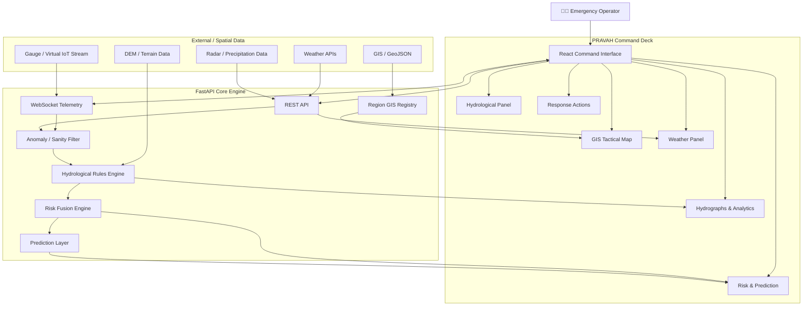

# 🌊 PRAVAH — Predictive River & Valley Hazard Alert System

<div align="center">


### **Predictive River & Valley Hazard Alert System**

**A real-time, GIS-aware early warning and tactical decision-support platform for mountain flash floods.**

</div>

---

## 📌 Project Overview

**PRAVAH** (Predictive River & Valley Hazard Alert System) is a real-time disaster-management platform designed for **mountainous and flash-flood-prone regions**.

The system combines:

- 🌧️ Live weather and precipitation data
- 🌊 River-level and hydrological telemetry
- 🗺️ GIS-based regional intelligence
- ⛰️ Terrain and watershed analysis
- 📈 Rainfall–river response analysis
- 🚨 Dynamic risk classification
- 🏘️ Settlement-level risk monitoring
- 🛣️ Evacuation and tactical routing
- 📊 Predictive analytics
- ⚡ Real-time frontend/backend synchronization

into a unified **Emergency Command Deck**.

Instead of presenting raw weather or river data independently, PRAVAH attempts to answer the operational question:

> **"What is happening, where is it happening, how severe could it become, and what should responders do next?"**

---

## 🎯 Problem Statement

Mountain flash floods can develop extremely quickly because of:

- High-intensity rainfall and cloudbursts
- Steep terrain
- Narrow river valleys
- Rapid runoff concentration
- Sudden river-stage increases
- Limited evacuation time
- Poor visibility of terrain-dependent hazards

Traditional dashboards often present weather, river gauges, maps, and warnings as separate information sources.

PRAVAH integrates these components into a single operational interface so that emergency personnel can observe the **entire hazard chain** spatially and temporally.

---

## 💡 Core Concept

PRAVAH follows a continuous operational pipeline:

```text
Weather / Telemetry Data
          │
          ▼
   Data Ingestion Layer
          │
          ▼
 Anomaly & Sanity Filtering
          │
          ▼
 Hydrological Analysis
          │
          ├───────────────► Rainfall Analysis
          │
          ├───────────────► River Stage Analysis
          │
          └───────────────► dh/dt Analysis
          │
          ▼
     Risk Fusion Engine
          │
          ▼
 GIS / Spatial Risk Mapping
          │
          ▼
 Settlement Risk Assessment
          │
          ▼
 Evacuation / Response Support
          │
          ▼
   Emergency Command Deck
```

---

# ✨ Key Features

## 🗺️ 1. GIS-Based Regional Command Map

PRAVAH provides a dedicated tactical map for each registered flood-prone region.

Each region can contain GIS registration data for:

- Rivers
- Settlements
- Shelters
- Roads
- Gauges
- Region boundaries
- Other spatial features

The system automatically loads the corresponding GIS configuration when an operator selects a region.

### Supported map layers

- Tactical dark basemap
- Terrain/topographic basemap
- Satellite imagery
- River network
- Monitored settlements
- Weather/radar overlays
- Risk zones
- Evacuation corridors
- Terrain-derived information

---

## 🌧️ 2. Real-Time Weather Monitoring

PRAVAH integrates live weather information relevant to the selected region.

The command deck can display:

- Temperature
- Precipitation
- Humidity
- Wind information
- Weather conditions
- Hourly observations
- Weather-derived risk indicators

Weather information is synchronized with the selected geographical region rather than being displayed as isolated data.

---

## 🌊 3. Hydrological Monitoring

The system continuously tracks river-related parameters and telemetry.

Important measurements include:

- River stage / water level
- Rainfall intensity
- Rate of river-level change
- Historical observations
- Current hydrological state
- Derived flood-risk indicators

The system uses the changing river level rather than relying only on a static flood threshold.

---

# 📈 4. Rainfall vs River-Level Analysis

PRAVAH includes a synchronized rainfall and river-stage visualization.

The visualization allows operators to observe:

```text
Rainfall
   │
   │       ███
   │      █████
   │   ███████
   │
   └──────────────────► Time

River Level
   │
   │             ╱───
   │           ╱
   │        ╱
   │______╱
   │
   └──────────────────► Time
```

This helps demonstrate the relationship between:

**Rainfall → Runoff → River Response**

and provides a visual indication of the temporal response of the river system.

---

# 📐 5. River Rise Rate — dh/dt

PRAVAH uses the rate of river-level change:

\[
\frac{dh}{dt}
\]

as an operational indicator.

Rather than only asking:

> "Is the river level high?"

the system also asks:

> **"How quickly is the river level rising?"**

Example configured thresholds:

| Rise Rate | State |
|---:|---|
| `< 1.0 cm/min` | 🟢 NORMAL |
| `1.0 – 2.0 cm/min` | 🟠 WATCH |
| `≥ 2.0 cm/min` | 🔴 CRITICAL |

These thresholds can be configured according to the monitored basin and operational requirements.

---

# 🚨 6. Dynamic Risk Classification

PRAVAH converts multiple observations into an operational risk state.

The system can combine:

- Rainfall intensity
- River stage
- River rise rate
- Weather conditions
- Terrain characteristics
- Spatial exposure
- Historical/derived indicators

to classify conditions into states such as:

```text
NORMAL
   ↓
WATCH
   ↓
CRITICAL
```

The purpose is to provide an interpretable operational state rather than forcing responders to manually interpret dozens of raw measurements.

---

# 🏘️ 7. Settlement-Level Risk Monitoring

Each registered settlement can be associated with spatial and demographic information.

The command deck provides an overview of monitored settlements and their current risk state.

Example:

| Settlement | Risk | Population |
|---|---|---:|
| Village A | 🟢 NORMAL | 1,240 |
| Village B | 🟠 WATCH | 3,100 |
| Village C | 🔴 CRITICAL | 2,450 |

This allows responders to immediately identify **which communities require attention**.

---

# 🛣️ 8. Tactical Evacuation Support

PRAVAH is designed to support evacuation planning using spatial information.

The system can combine:

- Road networks
- Settlement locations
- Shelter locations
- River channels
- Hazard zones
- Terrain information

to support identification of safer evacuation corridors.

The objective is not simply to find the shortest road.

Instead:

> **The preferred evacuation path should minimize exposure to flood hazards while remaining practically traversable.**

---

# ⛰️ 9. Terrain Intelligence

Mountain floods are strongly influenced by terrain.

PRAVAH can incorporate terrain-derived GIS variables such as:

### DEM — Digital Elevation Model

Provides elevation information.

Used to understand:

- Valley floors
- Ridges
- Elevation differences
- Relative height of settlements
- Potential high-ground areas

### Slope

Represents terrain steepness.

Useful for identifying:

- Steep terrain
- Potential runoff concentration
- Difficult evacuation areas
- Terrain-dependent hazard zones

### TWI — Topographic Wetness Index

Provides an indication of where water is more likely to accumulate based on terrain characteristics.

Conceptually:

### Topographic Wetness Index (TWI)

The Topographic Wetness Index estimates the tendency of terrain to accumulate water based on upslope contributing area and local slope:

$$
\mathrm{TWI} = \ln\left(\frac{a}{\tan\beta}\right)
$$

where:

- $a$ = **specific upslope contributing area** (upslope contributing area per unit contour width)
- $\beta$ = **local slope angle** (in radians)

Higher TWI values indicate areas with greater potential for water accumulation, while lower values generally correspond to better-drained or steeper terrain.

These terrain layers can be visualized on the tactical map when enabled.

---

# 🌧️ 10. Weather Radar Overlay

PRAVAH supports precipitation/radar visualization over the operational map.

The radar layer provides additional spatial context for active precipitation.

This allows an operator to visually compare:

```text
Rainfall / Radar
       +
River Network
       +
Settlements
       +
Terrain
       ↓
Potential Hazard Area
```

---

# 📊 11. Operational Data Table

The Command Deck contains a synchronized data table showing current and derived values.

Example categories include:

- Current weather
- Rainfall
- River level
- River rise rate
- Risk classification
- Predicted values
- Timestamp
- Sensor status

This provides a detailed numerical view beneath the higher-level visual dashboard.

---

# 🔮 12. Prediction & Risk Model

PRAVAH includes a predictive layer intended to estimate evolving flood risk.

The model can use features such as:

```text
Rainfall
River Stage
River Rise Rate
Weather Conditions
Terrain Features
Spatial Exposure
        │
        ▼
   Risk Model
        │
        ▼
Predicted Risk State
```

The predictive component is designed to complement, rather than replace, physical hydrological indicators and emergency judgement.

---

# ⚡ 13. Real-Time Backend ↔ Frontend Synchronization

One of the major technical features of PRAVAH is its live synchronization architecture.

The frontend does not operate as a static dashboard.

Instead:

```text
Telemetry / APIs
      ↓
FastAPI Backend
      ↓
Processing & Risk Engine
      ↓
Real-Time Data Stream
      ↓
React Command Deck
      ↓
Live Map + Graphs + Risk State
```

Changes in incoming data can propagate through the system and update the operational interface.

---

# 🧭 14. Multi-Region Architecture

PRAVAH is not restricted to a single river basin.

The system supports a registry-based architecture where new regions can be registered using GIS JSON configuration.

Example:

```json
{
  "region_id": "region_identifier",
  "name": "Example Basin",
  "state": "Uttarakhand",
  "district": "Example District"
}
```

A registered region can contain:

- Rivers
- Settlements
- Shelters
- Roads
- Gauges
- Spatial metadata

Once registered, the existing processing and dashboard pipeline can operate on the selected region.

This makes PRAVAH extensible to multiple mountainous flood-prone regions.

---

# 🖥️ Command Deck

The Command Deck is organized around the operational workflow of an emergency response team.

### Region Selection

Allows the operator to select the active monitored basin.

### Tactical Map

Provides the primary spatial operating picture.

### Settlement Risk

Shows the current status of monitored communities.

### Weather

Displays current meteorological conditions.

### Hydrology

Displays river and rainfall measurements.

### Hydrograph

Shows rainfall and river response over time.

### Data & Predictions

Provides detailed numerical observations and model outputs.

### Response Actions

Provides an interface for operational actions and response decisions.

---

# 🏗️ System Architecture



---

# 🔄 Real-Time Data Pipeline

```text
┌─────────────────────────┐
│ Weather / Telemetry APIs│
└────────────┬────────────┘
             ↓
┌─────────────────────────┐
│     Data Ingestion      │
└────────────┬────────────┘
             ↓
┌─────────────────────────┐
│ Anomaly / Sanity Filter │
└────────────┬────────────┘
             ↓
┌─────────────────────────┐
│ Hydrological Processing │
│                         │
│ • Rainfall              │
│ • River Stage           │
│ • dh/dt                 │
│ • Thresholds            │
└────────────┬────────────┘
             ↓
┌─────────────────────────┐
│     Risk Fusion Core    │
└────────────┬────────────┘
             ↓
┌─────────────────────────┐
│ GIS Spatial Intelligence│
└────────────┬────────────┘
             ↓
┌─────────────────────────┐
│   React Command Deck    │
└─────────────────────────┘
```

---

# 🧠 Hydrological Logic

PRAVAH uses both absolute and dynamic hydrological indicators.

### River Stage

Represents the current water level.

### River Rise Rate

$$
\frac{dh}{dt}
$$

This captures the speed at which river conditions are deteriorating.

### Why this matters

A river can currently be below an absolute danger level while rising extremely quickly.

Therefore:

```text
Absolute Level
       +
Rate of Change
       +
Rainfall
       ↓
More informative flood-risk assessment
```

---

# 🗺️ GIS Data Model

Each region can be represented using a GeoJSON-based registration structure.

Example:

```text
Region
├── Rivers
│   └── LineString
│
├── Settlements
│   └── Point / Polygon
│
├── Shelters
│   └── Point
│
├── Roads
│   └── LineString
│
└── Gauges
    └── Point
```

This makes the spatial layer modular and region-independent.

---

# 🛠️ Technology Stack

## Frontend

| Technology | Purpose |
|---|---|
| **React** | Command Deck interface |
| **TypeScript** | Type-safe frontend development |
| **Vite** | Frontend build/development tooling |
| **Leaflet / React-Leaflet** | Interactive GIS map |
| **GeoJSON** | Spatial feature representation |
| **Plotting Library** | Hydrological visualizations |

---

## Backend

| Technology | Purpose |
|---|---|
| **Python** | Data processing and analytical logic |
| **FastAPI** | REST API and backend service |
| **WebSockets** | Real-time telemetry synchronization |
| **Pandas / NumPy** | Data processing |
| **Scikit-learn / ML stack** | Predictive modeling |
| **SHAP** | Model explainability where applicable |

---

## GIS & Spatial Technologies

- GeoJSON
- Leaflet
- Digital Elevation Models
- Terrain analysis
- Slope analysis
- Topographic Wetness Index
- River network data
- Road network data
- Satellite imagery
- Weather/radar overlays

---

# 🧩 Project Structure

```text
PRAVAH/
│
├── README.md
├── .gitignore
│
├── backend/
│   ├── requirements.txt
│   ├── run.sh
│   │
│   └── app/
│       ├── main.py
│       │
│       ├── api/
│       │   └── router.py
│       │
│       ├── routes/
│       │   ├── evacuation.py
│       │   └── simulation.py
│       │
│       ├── services/
│       │   ├── hydrology/
│       │   ├── prediction/
│       │   ├── risk/
│       │   └── gis/
│       │
│       └── data/
│           └── regions/
│
└── frontend/
    ├── package.json
    ├── vite.config.*
    │
    └── src/
        ├── components/
        ├── pages/
        ├── maps/
        ├── charts/
        ├── services/
        ├── types/
        └── App.*
```

> Adjust the directory tree above to match the final repository structure.

---

# 🌐 Data Sources

PRAVAH is designed to combine multiple data sources rather than depending on a single provider.

Potential/implemented data categories include:

- Weather API data
- Precipitation/radar data
- Gauge/telemetry streams
- GeoJSON regional registration
- Digital Elevation Models
- River networks
- Road networks
- Satellite imagery
- Spatial terrain features

Individual data providers should be configured according to their current API terms, attribution requirements, and operational reliability.

---

# 🔐 Configuration

Create a backend `.env` file for API credentials and configuration values.

Example:

```env
WEATHER_API_KEY=your_key_here
OTHER_API_KEY=your_key_here
```

**Never commit API keys to Git.**

Use:

```text
.env
```

inside `.gitignore`.

Public map tile services and APIs should also be used according to their respective usage policies and attribution requirements.

---

# 🚀 Getting Started

## Prerequisites

- Python 3.10+
- Node.js 18+
- npm
- Git

---

## 1. Clone the Repository

```bash
git clone <YOUR_REPOSITORY_URL>
cd PRAVAH
```

---

## 2. Backend Setup

```bash
cd backend
```

Create a virtual environment:

```bash
python -m venv .venv
```

### Windows

```bash
.venv\Scripts\activate
```

### Linux/macOS

```bash
source .venv/bin/activate
```

Install dependencies:

```bash
pip install -r requirements.txt
```

Configure environment variables:

```env
# backend/.env

YOUR_API_KEY=your_key
```

Start the backend:

```bash
uvicorn app.main:app --reload --host 0.0.0.0 --port 8000
```

---

## 3. Frontend Setup

Open another terminal:

```bash
cd frontend
```

Install dependencies:

```bash
npm install
```

Start the development server:

```bash
npm run dev
```

Open the displayed local development URL in your browser.

---

# 📡 Real-Time Telemetry

PRAVAH supports a telemetry pipeline designed to simulate or receive continuously changing gauge measurements.

Conceptually:

```text
Gauge / Simulator
       ↓
WebSocket / API
       ↓
FastAPI
       ↓
Processing
       ↓
Risk Calculation
       ↓
Frontend
       ↓
Map + Graph + Status
```

This architecture allows simulated telemetry to be replaced by actual sensor streams without fundamentally redesigning the dashboard.

---

# 🧪 Simulation Mode

For demonstrations and development, PRAVAH can operate using simulated telemetry.

The simulator can generate changing:

- Rainfall
- River stage
- River rise rate
- Risk state

This makes it possible to demonstrate the complete operational loop without requiring physical IoT hardware.

### Demonstration flow

```text
Simulated Cloudburst
        ↓
Rainfall Increase
        ↓
River-Level Response
        ↓
dh/dt Increase
        ↓
Risk Escalation
        ↓
Settlement Status Update
        ↓
Command Deck Update
```

---

# 🚨 Operational Scenario

A typical PRAVAH scenario can be represented as:

### Stage 1 — Normal

```text
Rainfall: Low
River rise: Stable
Risk: NORMAL
```

The system continues monitoring.

### Stage 2 — Heavy Rainfall

```text
Rainfall ↑
River response begins
Risk → WATCH
```

The operator receives an early indication of deteriorating conditions.

### Stage 3 — Rapid River Rise

```text
dh/dt ≥ critical threshold
Risk → CRITICAL
```

The command deck highlights affected areas and provides the operational information required for response.

### Stage 4 — Response

The operator can inspect:

- Affected settlements
- River network
- Hazard areas
- Available shelters
- Evacuation corridors
- Weather/radar
- Terrain context

and initiate appropriate emergency actions.

---

# 📊 Why PRAVAH Is Different

Traditional flood monitoring often focuses on individual measurements:

```text
Rainfall → Graph
River Level → Graph
Weather → Panel
Map → Separate System
```

PRAVAH attempts to connect them:

```text
             WEATHER
                │
                ▼
RAINFALL ──► HYDROLOGY ──► RISK
                │             │
                ▼             ▼
             RIVER        SETTLEMENTS
                │             │
                └──────┬──────┘
                       ▼
                 TACTICAL MAP
                       │
                       ▼
                RESPONSE ACTION
```

The goal is to transform **data monitoring into operational situational awareness**.

---

# 🏆 Hackathon / Demonstration Highlights

PRAVAH was designed as a complete operational prototype rather than a static UI mockup.

Key demonstration capabilities include:

- ✅ Real-time data fetching
- ✅ Backend/frontend synchronization
- ✅ GIS-based regional switching
- ✅ Dynamic command deck
- ✅ Hydrological monitoring
- ✅ Rainfall–river analysis
- ✅ River rise-rate monitoring
- ✅ Settlement risk classification
- ✅ Terrain-aware spatial analysis
- ✅ Tactical map layers
- ✅ Multi-region registration
- ✅ Predictive risk architecture
- ✅ Emergency response interface

---

# 🧠 Technical Challenges

### 1. Synchronizing heterogeneous data

Weather, river telemetry, GIS features, and model outputs operate on different data structures and update frequencies.

PRAVAH therefore separates:

```text
Data ingestion
      ↓
Normalization
      ↓
Processing
      ↓
Risk state
      ↓
Visualization
```

---

### 2. Handling real-time updates

A command dashboard cannot behave like a conventional static web page.

The frontend must react to:

- New telemetry
- Changing risk states
- Updated weather
- Updated predictions
- Spatial changes

without requiring the entire page to reload.

---

### 3. Making complex information readable

Emergency operators cannot spend minutes interpreting raw datasets.

Therefore PRAVAH emphasizes:

- Clear risk states
- High-contrast map layers
- Operational thresholds
- Compact graphs
- Settlement-level status
- Spatial visualization

---

### 4. GIS extensibility

Hardcoding individual basins would make the system difficult to scale.

The region registry architecture allows new regions to be added using structured GIS JSON data.

---

# 🔮 Future Development

Potential future improvements include:

- [ ] Integration with real government/IoT gauge stations
- [ ] Automated flood inundation modeling
- [ ] High-resolution DEM processing
- [ ] Real-time river discharge estimation
- [ ] Advanced rainfall–runoff modeling
- [ ] ML-based flood forecasting
- [ ] Automated flood-zone generation
- [ ] Risk-weighted evacuation routing
- [ ] Road blockage detection
- [ ] Satellite-based flood extent detection
- [ ] SMS / cell broadcast emergency alerts
- [ ] Low-bandwidth emergency mode
- [ ] Offline map tile caching
- [ ] Multi-user command center support
- [ ] Role-based access control
- [ ] Historical event replay
- [ ] Model explainability dashboard
- [ ] Integration with official disaster-management systems

---

# ⚠️ Important Disclaimer

PRAVAH is a **research, educational, and prototype disaster-management system**.

Its outputs should not be treated as an authoritative emergency warning or as a replacement for:

- Government disaster-management authorities
- Official flood warnings
- Certified hydrological models
- Professional emergency responders
- Official evacuation orders

Real-world deployment would require extensive validation, calibrated sensors, authoritative GIS datasets, hydrological modeling, redundancy, cybersecurity, reliability testing, and approval from the relevant disaster-management authorities.

---

# 👥 Project

**PRAVAH — Predictive River & Valley Hazard Alert System**

Designed for:

> **Real-time flood-risk awareness, GIS-based situational intelligence, and tactical emergency decision support in mountainous regions.**

---

<div align="center">

### 🌊 PRAVAH

**Observe → Analyze → Predict → Respond**

*Turning real-time environmental data into actionable disaster intelligence.*

</div>
